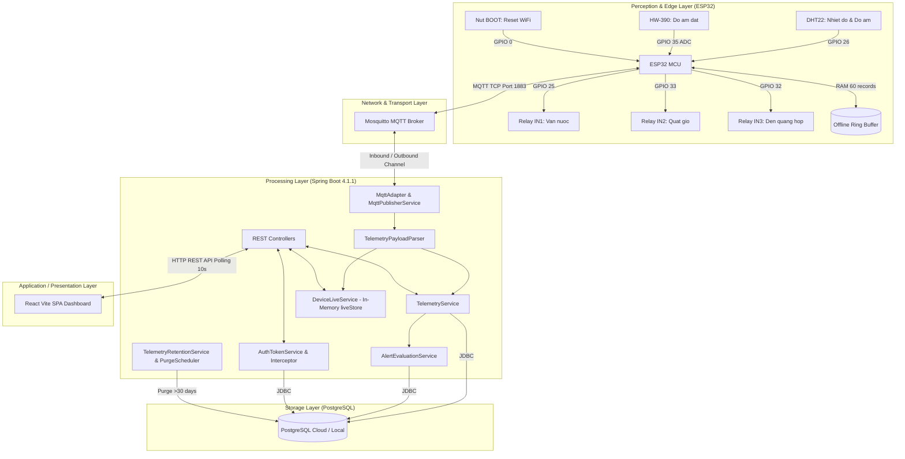
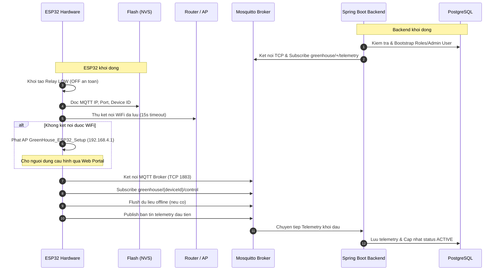
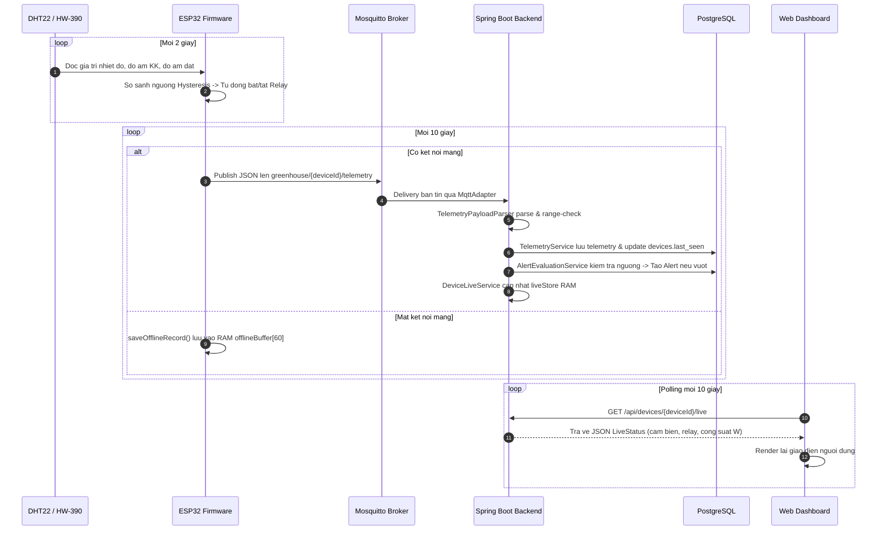
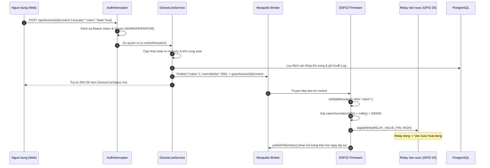
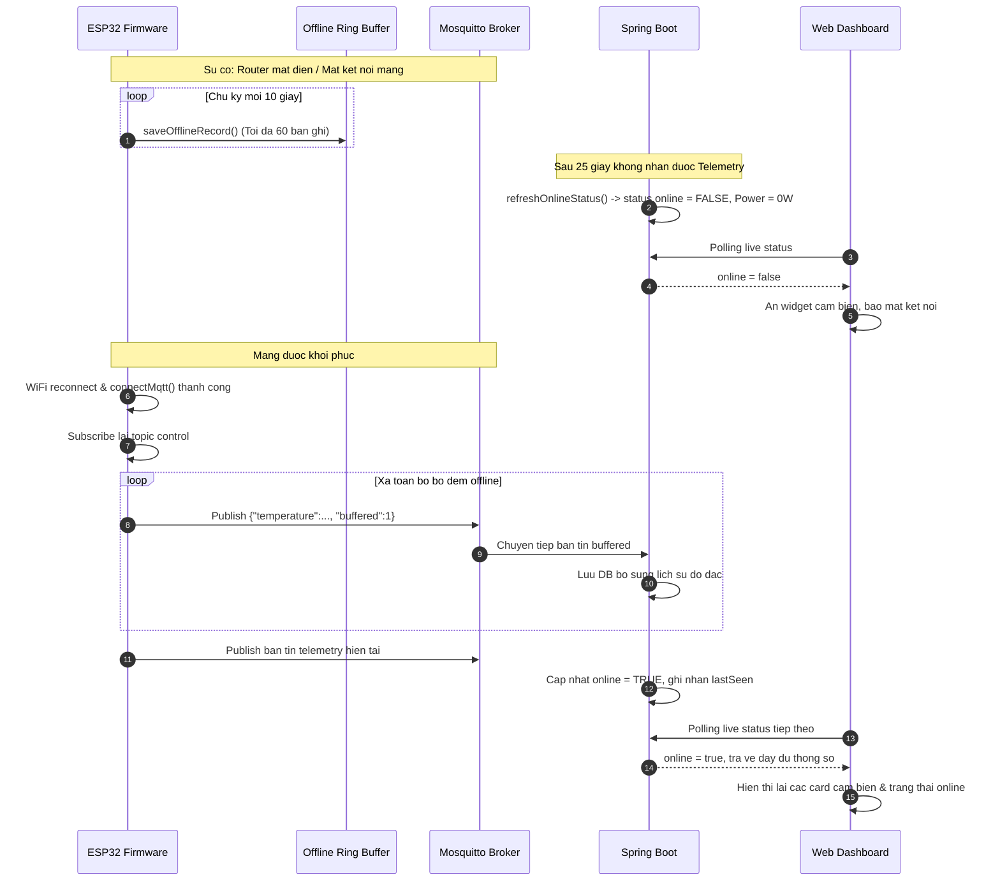

# BÁO CÁO PHÂN TÍCH HỆ THỐNG IOT GREENHOUSE
**(REVERSE-ENGINEERING & CODE AUDIT REPORT)**

---

## 1. TỔNG QUAN HỆ THỐNG

### 1.1 Mục đích và bài toán giải quyết
Hệ thống **IoT Greenhouse** (Nhà kính thông minh) giải quyết bài toán giám sát điều kiện vi khí hậu và tự động hóa cơ cấu chấp hành trong nhà kính nông nghiệp:
- **Giám sát môi trường**: Thu thập các chỉ số nhiệt độ không khí, độ ẩm không khí và độ ẩm của đất trồng.
- **Tự động hóa chấp hành**: Tự động kích hoạt van tưới nước khi đất khô, bật quạt thông gió khi nhiệt độ tăng cao, và bật đèn quang hợp khi nhiệt độ môi trường hạ thấp; đồng thời cho phép người dùng can thiệp điều khiển thủ công từ xa hoặc kích hoạt ngắt khẩn cấp.
- **Vận hành & Giám sát tập trung**: Cung cấp giao diện Web Dashboard quản lý trực quan thời gian thực, quản lý cảnh báo (Alerts) đa mức, cấu hình ngưỡng động, quản lý vòng đời node thiết bị (Device Lifecycle), nhật ký kiểm toán (Audit Log) và phân quyền người dùng (RBAC).

*Bằng chứng trong code:*
- `firmware/esp32_telemetry/esp32_telemetry.ino:2-5`:
  ```cpp
  * DỰ ÁN: IOT GREENHOUSE (Nhà kính thông minh)
  * FIRMWARE: ESP32 Telemetry & Actuator Controller (Tích hợp Web WiFiManager)
  ```
- `backend/src/main/resources/application.properties:1`:
  ```properties
  spring.application.name=greenhouse
  ```

---

### 1.2 Danh sách thành phần chính và công nghệ sử dụng
| Thành phần | Vai trò | Công nghệ / Ngôn ngữ / Framework | Thư viện & Công cụ chính |
|---|---|---|---|
| **Firmware Node** | Đọc cảm biến, kích relay, gửi nhận tin MQTT, captive portal | C++ / Arduino Framework cho ESP32 | `WiFi.h`, `PubSubClient.h`, `DHT.h`, `WiFiManager.h`, `Preferences.h` |
| **MQTT Broker** | Trung gian điều phối message publish/subscribe | Eclipse Mosquitto (port 1883) | Mosquitto Server v2 |
| **Backend Server** | Nhận telemetry, xử lý logic, phân quyền RBAC, REST API, lưu trữ DB | Java 17, Spring Boot 4.1.1 (Maven) | Spring Data JPA, Spring Security Crypto (BCrypt), Spring Integration MQTT (`org.eclipse.paho.client.mqttv3`), HikariCP, Jackson Databind, Lombok |
| **Database** | Lưu trữ quan hệ: user, session, device, telemetry, alert, audit log | PostgreSQL | Neon Cloud Database (AWS ap-southeast-1) / Render Managed PostgreSQL |
| **Frontend Web** | Giao diện quản trị, dashboard giám sát, bảng điều khiển thiết bị | JavaScript (React 19, JSX) | Vite, React Router DOM v7, Lucide React (`lucide-react`) |
| **Triển khai / DevOps**| Đóng gói và chạy môi trường cloud/local | Docker, Render Blueprint | Dockerfile (Eclipse Temurin 17), `render.yaml` |

*Bằng chứng trong code:*
- `backend/pom.xml:8, 30, 42-64`: Khai báo Java 17, Spring Boot, Paho MQTT 1.2.5, PostgreSQL.
- `frontend/package.json:11-18`: Khai báo React 19.0.0, Vite, Lucide-react.
- `backend/Dockerfile:2, 17`: Khai báo base image `eclipse-temurin:17-jdk-jammy` và `eclipse-temurin:17-jre-jammy`.

---

### 1.3 Cấu trúc thư mục và vai trò từng module
```
IOT_GreenHouse/
├── firmware/
│   └── esp32_telemetry/
│       ├── esp32_telemetry.ino        # Toàn bộ mã nguồn C++ firmware cho ESP32
│       └── README.md                  # Hướng dẫn nạp và hợp đồng payload telemetry
├── backend/
│   ├── src/main/java/com/iot/greenhouse/
│   │   ├── adapter/                   # Bộ chuyển đổi giao thức MQTT (MqttAdapter, TelemetryPayloadParser)
│   │   ├── config/                    # Cấu hình hệ thống (AuthBootstrap, AuthInterceptor, MqttConfig, WebConfig)
│   │   ├── controller/                # Các REST Controller tiếp nhận yêu cầu HTTP từ Web
│   │   ├── entity/                    # Các thực thể JPA ánh xạ tới bảng trong PostgreSQL
│   │   ├── model/                     # Model đối tượng nghiệp vụ in-memory (DeviceLiveStatus)
│   │   ├── repository/                # Spring Data JPA Repositories truy vấn cơ sở dữ liệu
│   │   └── service/                   # Nghiệp vụ: Telemetry, AlertEvaluation, DeviceLive, AuditLog, AuthToken
│   ├── src/main/resources/
│   │   └── application.properties     # Cấu hình Spring Boot, kết nối database, MQTT, port, CORS
│   ├── Dockerfile                     # Đóng gói backend dạng Docker image 2 giai đoạn
│   └── pom.xml                        # File cấu hình phụ thuộc Maven
├── frontend/
│   ├── src/
│   │   ├── api.js                     # Module bọc fetch HTTP, quản lý Bearer token & session
│   │   ├── App.jsx                    # Root component, routing, Dashboard chính, điều khiển thiết bị
│   │   ├── pages.jsx                  # Các trang nghiệp vụ: Alerts, Lifecycle, Users, AuditLogs, Settings
│   │   ├── avatar.js                  # Tiện ích hiển thị avatar và phân cấp vai trò
│   │   └── styles.css                 # Toàn bộ CSS giao diện web
│   ├── package.json                   # Cấu hình dependencies Node.js
│   └── vite.config.js                 # Cấu hình Vite build tool
├── database/
│   ├── create_tables.sql              # Script DDL khởi tạo toàn bộ các bảng, ràng buộc CHECK và khóa ngoại
│   └── migrations/
│       └── 002_user_sessions.sql      # Script migration bảng user_sessions
├── render.yaml                        # Blueprint triển khai tự động lên Render.com
├── HUONG_DAN_CHAY_LOCAL.txt           # Tài liệu quy trình chạy thử nghiệm local
└── HUONG_DAN_TRIEN_KHAI_RENDER.txt    # Tài liệu quy trình deploy lên Cloud Render
```

---

## 2. KIẾN TRÚC HỆ THỐNG

### 2.1 Các lớp kiến trúc và thành phần
1. **Lớp Thiết bị / Cảm nhận (Perception/Device Layer)**:
   - Module vi điều khiển: ESP32 Dev Module (ESP32-WROOM-32).
   - Cảm biến: DHT22 (nhiệt độ, độ ẩm không khí), HW-390 (độ ẩm đất điện dung).
   - Cơ cấu chấp hành: Module Relay 4 kênh (kết nối Van nước, Quạt thông gió, Đèn quang hợp).
2. **Lớp Mạng / Truyền thông (Network Layer)**:
   - Mạng Wi-Fi 802.11 b/g/n (ESP32 kết nối router LAN hoặc phát AP cấu hình `GreenHouse_ESP32_Setup`).
   - MQTT qua TCP cổng 1883 (kết nối ESP32 - Mosquitto - Backend).
   - HTTP/REST qua TCP cổng 8080/5173 (kết nối Frontend - Backend).
3. **Lớp Xử lý / Dịch vụ (Processing/Backend Layer)**:
   - Spring Boot Application tiếp nhận MQTT inbound, phân tích JSON payload (`TelemetryPayloadParser`), xử lý nghiệp vụ lưu trữ (`TelemetryService`), cập nhật trạng thái thời gian thực (`DeviceLiveService`), đánh giá ngưỡng cảnh báo (`AlertEvaluationService`), xuất bản lệnh ra MQTT (`MqttPublisherService`), kiểm soát phiên làm việc và bảo mật (`AuthInterceptor`, `AuthTokenService`).
4. **Lớp Lưu trữ (Storage Layer)**:
   - **Database (PostgreSQL)**: Lưu bảng dữ liệu lâu dài (`users`, `user_sessions`, `roles`, `devices`, `device_configurations`, `telemetry`, `alerts`, `audit_logs`, `commands`, `firmware_versions`).
   - **Bộ đệm In-Memory (RAM)**:
     + ESP32: Vòng đệm `offlineBuffer[60]` lưu tối đa 60 bản tin cảm biến khi mất kết nối.
     + Backend: `ConcurrentHashMap<String, DeviceLiveStatus> liveStore` lưu trạng thái hoạt động trực tiếp, công suất tải, thời gian khóa override của thiết bị.
5. **Lớp Ứng dụng / Giao diện (Application/UI Layer)**:
   - Giao diện Single Page Application (React Vite) phục vụ người dùng giám sát telemetry, thực hiện bật/tắt thiết bị, ngắt khẩn cấp, cài đặt ngưỡng, quản lý người dùng và nhật ký audit log.

---

### 2.2 Mô hình giao tiếp
- **Publish / Subscribe**: Áp dụng giữa ESP32 và Spring Boot Backend thông qua MQTT Broker Mosquitto:
  + ESP32 publish telemetry -> Broker -> Backend subscribe.
  + Backend publish control -> Broker -> ESP32 subscribe.
- **Request / Response**: Áp dụng giữa Web Frontend và Backend Spring Boot qua chuẩn HTTP REST API (JSON).
- **Polling**: Web Frontend thực hiện cơ chế Polling định kỳ mỗi 10 giây (`refreshIntervalMs = 10000`, `App.jsx:88, 489, 1255`) và polling cảnh báo mỗi 30 giây (`loadBell`, `App.jsx:219`). Không sử dụng WebSocket hay Server-Sent Events (SSE).
- **Event-driven**: Backend kích hoạt chuỗi xử lý ngay khi có Message từ MQTT Inbound Channel (`MqttAdapter.java:88-107`).

---

### 2.3 Nơi xử lý dữ liệu và nơi lưu trữ
- **Xử lý tại Biên (Edge Processing)**: ESP32 đọc ADC, hiệu chỉnh thang đo độ ẩm đất, chạy thuật toán so sánh ngưỡng với dải trễ (hysteresis) để tự đóng/ngắt relay, quản lý thời gian khóa thủ công 5 phút (override timer), lưu đệm RAM khi ngắt mạng.
- **Xử lý tại Server**: Spring Boot kiểm tra tính hợp lệ dữ liệu (kiểm tra kiểu, lọc ngoại lai), lưu vào PostgreSQL, cập nhật `lastSeen`, đối chiếu ngưỡng để tạo bản ghi `Alert`, quản lý tác vụ xóa dữ liệu cũ định kỳ (`TelemetryRetentionService`).
- **Nơi lưu trữ**:
  + Cơ sở dữ liệu chính: PostgreSQL (`telemetry`, `devices`, `alerts`, `audit_logs`, `users`, `user_sessions`).
  + Trạng thái bật/tắt và công suất relay thời gian thực: Chỉ lưu tại RAM backend (`DeviceLiveService.liveStore`), **không lưu vào database**.

---

### 2.4 Sơ đồ kiến trúc hệ thống


---

## 3. THIẾT BỊ (DEVICES)

| Tên thiết bị | Loại | Vi điều khiển / Board | Chân GPIO / Bus | Thư viện dùng | Dữ liệu đọc / ghi | ID / Định danh trong code | Bằng chứng mã nguồn |
|---|---|---|---|---|---|---|---|
| **ESP32 Dev Module** | Node MCU / Gateway biên | ESP32-WROOM-32 (NodeMCU-32S) | - | `WiFi.h`, `PubSubClient.h`, `WiFiManager.h`, `Preferences.h` | Quản lý logic toàn node, đọc cảm biến, gửi telemetry, nhận lệnh | `device_id` (mặc định `"esp32-01"`) | `esp32_telemetry.ino:65`: `char device_id[32] = "esp32-01";` |
| **DHT22 (AM2302)** | Cảm biến số | ESP32 | **GPIO 26** (Digital 1-wire) *(Lưu ý: git diff vừa đổi từ 27 -> 26)* | `DHT.h` (Adafruit DHT Sensor Library) | Đọc: Nhiệt độ không khí (°C, dải đo -40 đến 80), Độ ẩm không khí (% RH, 0-100) | `DHTPIN` (26), `dht` | `esp32_telemetry.ino:71-73`: `#define DHTPIN 26`, `DHT dht(DHTPIN, DHTTYPE);` |
| **HW-390** | Cảm biến tương tự | ESP32 | **GPIO 35** (Analog ADC1_CH7) | Hàm chuẩn Arduino `analogRead()` | Đọc: Điện áp ADC thô (1400 - 3200), quy đổi độ ẩm đất (%: 0 - 100) | `SOIL_PIN` (35), `soilRaw`, `soilMoisture` | `esp32_telemetry.ino:75, 78-79`: `#define SOIL_PIN 35`, `AIR_VALUE = 3200; WATER_VALUE = 1400;` |
| **BH1750 (Ánh sáng)** | Cảm biến I2C | ESP32 | *Không tìm thấy trong code esp32_telemetry.ino* | Không có trong file `.ino` | Backend có parser trường `light`, nhưng firmware không có code đọc BH1750 | `light` | `README.md:48` (nhắc tên nhưng code `.ino` không có) |
| **Van tưới nước** | Cơ cấu chấp hành | ESP32 qua Relay Kênh 1 | **GPIO 25** (Digital Output) | `digitalWrite()` | Ghi: Mức HIGH (Bật - P=4.8W), Mức LOW (Tắt - P=0W) | `RELAY_VALVE_PIN` (25), `"valve"` | `esp32_telemetry.ino:82, 386`, `DeviceLiveService.java:54` |
| **Quạt thông gió** | Cơ cấu chấp hành | ESP32 qua Relay Kênh 2 | **GPIO 33** (Digital Output) | `digitalWrite()` | Ghi: Mức HIGH (Bật - P=1.8W), Mức LOW (Tắt - P=0W) | `RELAY_FAN_PIN` (33), `"fan"` | `esp32_telemetry.ino:83, 387`, `DeviceLiveService.java:55` |
| **Đèn quang hợp LED**| Cơ cấu chấp hành | ESP32 qua Relay Kênh 3 | **GPIO 32** (Digital Output) | `digitalWrite()` | Ghi: Mức HIGH (Bật - P=9.6W), Mức LOW (Tắt - P=0W) | `RELAY_LIGHT_PIN` (32), `"light"` | `esp32_telemetry.ino:84, 388`, `DeviceLiveService.java:56` |
| **Relay Kênh 4 (IN4)**| Cơ cấu chấp hành | ESP32 | Bỏ trống / Không nối | - | Không sử dụng | `IN4` | `esp32_telemetry.ino:45`: `IN4 -> Bỏ trống` |
| **Nút BOOT** | Nút bấm vật lý | ESP32 | **GPIO 0** (Input Pull-up) | `digitalRead()` | Đọc: Nhấn giữ liên tục >= 3000ms để xóa cấu hình Wi-Fi và reboot | `TRIGGER_PIN` (0) | `esp32_telemetry.ino:57, 549-560` |

---

## 4. GIAO THỨC VÀ KẾT NỐI

### 4.1 Giao thức từng chặng
1. **ESP32 <-> Bộ định tuyến Wi-Fi**: Chuẩn 802.11 b/g/n (2.4GHz). Tự động kết nối lại khi mất sóng thông qua WiFi Event listener `ARDUINO_EVENT_WIFI_STA_DISCONNECTED` (`esp32_telemetry.ino:466-470`).
2. **ESP32 <-> Mosquitto MQTT Broker**: Giao thức MQTT v3.1.1 qua TCP, cổng 1883, truyền tin không mã hóa TLS.
3. **Backend <-> Mosquitto MQTT Broker**: Paho MQTT Client qua TCP, cổng 1883.
4. **Backend <-> PostgreSQL**: JDBC kết nối TCP cổng 5432 qua giao thức PostgreSQL có mã hóa SSL (`sslmode=require` trên Neon Cloud).
5. **Web Frontend <-> Backend**: HTTP/1.1 REST API qua cổng 8080 (hoặc HTTPS trên cloud), dữ liệu định dạng JSON.

---

### 4.2 Thông số cấu hình Broker & MQTT Client
- **Broker Host / Port**: Mặc định `tcp://localhost:1883` hoặc LAN `192.168.1.120:1883` (`application.properties:22`, `esp32_telemetry.ino:63-64`).
- **Clean Session**:
  + Backend: `cleanSession=false` (`application.properties:28`, `MqttConfig.java:24, 35`).
  + ESP32: Mặc định của PubSubClient (`cleanSession=true`).
- **Keepalive Interval**:
  + Backend: 30 giây (`MqttConfig.java:41`: `options.setKeepAliveInterval(30);`).
  + ESP32: Mặc định 15 giây trong thư viện `PubSubClient`.
- **Quality of Service (QoS)**:
  + ESP32 Publish: QoS 0 (hàm `mqtt.publish(topic, payload)` mặc định QoS 0 trong PubSubClient).
  + Backend Subscribe: QoS 1 (`MqttAdapter.java:62`: `adapter.setQos(1);`).
  + Backend Publish: QoS 1 (`MqttAdapter.java:84`: `messageHandler.setDefaultQos(1);`).
- **Retain flag**: Mặc định `false` cho tất cả các chiều gửi.
- **LWT (Last Will and Testament)**: **Không tìm thấy trong code** (cả ESP32 và Backend đều không khai báo `setWill`).

---

### 4.3 Danh sách MQTT Topics và REST API Endpoints

#### Bảng MQTT Topics
| Tên Topic | Hướng | Người gửi -> Người nhận | Định dạng & Cấu trúc Payload | Bằng chứng |
|---|---|---|---|---|
| `greenhouse/{deviceId}/telemetry` | Publish -> Subscribe | ESP32 -> Spring Boot Backend | JSON: Nhiệt độ, độ ẩm, trạng thái relay, ngưỡng, thời gian khóa, công suất | `esp32_telemetry.ino:380-398`, `MqttAdapter.java:31` |
| `greenhouse/{deviceId}/control` | Publish -> Subscribe | Spring Boot Backend -> ESP32 | JSON: Lệnh bật/tắt relay, chế độ tự động, cập nhật ngưỡng | `esp32_telemetry.ino:225-325`, `DeviceLiveService.java:379, 479, 523` |

#### Ví dụ Payload thực tế từ code
**1. Payload Telemetry (ESP32 gửi lên):**
```json
{
  "temperature": 28.5,
  "humidity": 65.0,
  "soilMoisture": 45,
  "auto": 1,
  "tempThreshold": 35.0,
  "soilThreshold": 30,
  "lightTempThreshold": 20.0,
  "totalPowerW": 4.8,
  "valve": 1,
  "fan": 0,
  "light": 0,
  "valveOverrideSec": 280,
  "fanOverrideSec": 0,
  "lightOverrideSec": 0,
  "actuators": [
    {"id":"valve","name":"Van tưới nước (IN1)","pin":"GPIO 25 (IN1)","type":"VALVE","state":1,"powerW":4.8,"ratedW":4.8},
    {"id":"fan","name":"Quạt thông gió (IN2)","pin":"GPIO 33 (IN2)","type":"FAN","state":0,"powerW":0.0,"ratedW":1.8},
    {"id":"light","name":"Đèn quang hợp (IN3)","pin":"GPIO 32 (IN3)","type":"LIGHT","state":0,"powerW":0.0,"ratedW":9.6}
  ]
}
```
*(Trích từ `esp32_telemetry.ino:380-396`)*

**2. Payload Telemetry Buffered (Gửi bù khi kết nối lại):**
```json
{
  "temperature": 29.1,
  "humidity": 62.0,
  "soilMoisture": 28,
  "valve": 1,
  "fan": 0,
  "light": 0,
  "buffered": 1
}
```
*(Trích từ `esp32_telemetry.ino:198-203`)*

**3. Payload Control (Backend gửi xuống):**
- Điều khiển relay thủ công: `{"valve":1,"overrideSec":300}` (`DeviceLiveService.java:379`)
- Chuyển chế độ: `{"auto":1}` hoặc `{"auto":0}` (`DeviceLiveService.java:479`)
- Cấu hình ngưỡng: `{"tempThreshold":36.0,"soilThreshold":35.0,"lightTempThreshold":18.0,"auto":1}` (`DeviceLiveService.java:521-528`)
- Ngắt khẩn cấp: `{"valve":0,"fan":0,"light":0}` (`DeviceLiveService.java:290`)

#### Bảng REST API Endpoints chính
| Endpoint | Method | Vai trò / Quyền hạn | Mục đích nghiệp vụ | Bằng chứng |
|---|---|---|---|---|
| `/api/auth/login` | POST | Public (Bỏ qua Auth) | Đăng nhập bằng username/password, nhận Bearer token | `AuthController.java:35` |
| `/api/auth/me` | GET | Đã đăng nhập (Mọi Role) | Lấy thông tin user hiện tại từ token | `AuthController.java:83` |
| `/api/auth/logout` | POST | Đã đăng nhập (Mọi Role) | Thu hồi phiên đăng nhập hiện tại | `AuthController.java:88` |
| `/api/devices` | GET | Đã đăng nhập (Mọi Role) | Danh sách tất cả các node thiết bị | `DeviceRestController.java:46` |
| `/api/devices` | POST | `ADMIN` | Đăng ký mới một node thiết bị | `DeviceRestController.java:64` |
| `/api/devices/{deviceId}` | GET / PUT / DELETE | `ADMIN` | Xem chi tiết / Cập nhật / Xóa thiết bị | `DeviceRestController.java:51, 99, 142` |
| `/api/devices/{deviceId}/status`| PATCH | `ADMIN` | Cập nhật trạng thái vòng đời node | `DeviceRestController.java:158` |
| `/api/devices/{deviceId}/live` | GET | Đã đăng nhập (Mọi Role) | Lấy trạng thái hoạt động in-memory thời gian thực | `DeviceControlRestController.java:24` |
| `/api/devices/{deviceId}/control` | POST | `ADMIN`, `OPERATOR` | Điều khiển relay hoặc chuyển chế độ Auto | `DeviceControlRestController.java:34` |
| `/api/devices/{deviceId}/thresholds`| PUT | `ADMIN`, `OPERATOR` | Cập nhật ngưỡng nhiệt độ, độ ẩm đất, đèn | `DeviceControlRestController.java:59` |
| `/api/devices/{deviceId}/quick-action`| POST | `ADMIN`, `OPERATOR` | Hành động nhanh (water_on, fan_on, stop_all...) | `DeviceControlRestController.java:102` |
| `/api/telemetry?deviceId=...` | GET | Đã đăng nhập (Mọi Role) | Lấy toàn bộ lịch sử đo đạc của thiết bị | `TelemetryRestController.java:19` |
| `/api/alerts` | GET | Đã đăng nhập (Mọi Role) | Danh sách cảnh báo có phân trang và lọc | `AlertRestController.java:43` |
| `/api/alerts/{id}/acknowledge`| POST | `ADMIN`, `OPERATOR` | Xác nhận đã xem cảnh báo | `AlertRestController.java:78` |
| `/api/alerts/{id}/resolve` | POST | `ADMIN`, `OPERATOR` | Đóng/Xử lý xong cảnh báo | `AlertRestController.java:100` |
| `/api/audit-logs` | GET | `ADMIN` | Tra cứu nhật ký kiểm toán hệ thống | `AuditLogRestController.java:34` |
| `/api/users` | GET / POST | `ADMIN` | Quản lý danh sách tài khoản người dùng | `UserRestController.java:57, 88` |
| `/api/users/{id}/role` | PATCH | `ADMIN` | Đổi quyền vai trò tài khoản | `UserRestController.java:163` |
| `/api/system/status` | GET | Đã đăng nhập (Mọi Role) | Kiểm tra trạng thái kích hoạt MQTT của hệ thống | `SystemStatusRestController.java:15` |

---

### 4.4 Cơ chế kết nối lại, timeout và bộ đệm offline
- **ESP32 Wi-Fi Reconnect**: Sử dụng `WiFi.setAutoReconnect(true)` và bắt sự kiện `WiFi.onEvent(...)` gọi `WiFi.reconnect()`. Nếu ngắt kết nối quá 30 giây, firmware chủ động gọi `WiFi.begin()` nạp lại cấu hình từ NVS Flash (`esp32_telemetry.ino:466-470, 703`).
- **ESP32 MQTT Reconnect**: Lặp kiểm tra mỗi 5000ms (`MQTT_RETRY_MS = 5000`, `esp32_telemetry.ino:341`).
- **Bộ đệm Offline (Offline Buffer)**: ESP32 khai báo mảng vòng trong RAM:
  `OfflineRecord offlineBuffer[60]` (lưu tối đa 60 bản tin tương đương 10 phút mất mạng).
  Khi mất mạng, hàm `saveOfflineRecord()` được gọi; khi kết nối lại, hàm `flushOfflineRecords()` đẩy bù toàn bộ lên topic telemetry (`esp32_telemetry.ino:160-209`).
- **Server Liveness Timeout**: Backend kiểm tra `lastSeen`. Nếu không nhận được telemetry mới trong vòng **25 giây**, backend tự động đánh dấu thiết bị là `online = false` và đưa công suất tiêu thụ về 0.0W (`DeviceLiveService.java:63-91`).

---

## 5. ĐIỀU KHIỂN (CONTROL)

### 5.1 Các lệnh điều khiển và đường đi
| Lệnh điều khiển | Nguồn phát | Đường đi | Thiết bị thực thi | Phản hồi (ACK/Status) | Bằng chứng |
|---|---|---|---|---|---|
| Bật/Tắt Van nước (`valve: 1/0`) | Nút gạt trên Web UI | Web -> REST API -> Backend -> MQTT Outbound -> Broker -> ESP32 | Relay IN1 (GPIO 25) | ESP32 gửi ngay 1 bản tin `publishTelemetry()` lên MQTT; Web polling cập nhật | `esp32_telemetry.ino:232-244`, `DeviceLiveService.java:376-380` |
| Bật/Tắt Quạt gió (`fan: 1/0`) | Nút gạt trên Web UI | Web -> REST API -> Backend -> MQTT Outbound -> Broker -> ESP32 | Relay IN2 (GPIO 33) | ESP32 gửi ngay 1 bản tin `publishTelemetry()` lên MQTT | `esp32_telemetry.ino:246-258` |
| Bật/Tắt Đèn (`light: 1/0`) | Nút gạt trên Web UI | Web -> REST API -> Backend -> MQTT Outbound -> Broker -> ESP32 | Relay IN3 (GPIO 32) | ESP32 gửi ngay 1 bản tin `publishTelemetry()` lên MQTT | `esp32_telemetry.ino:260-272` |
| Dừng khẩn cấp (`stop_all`) | Nút "Dừng khẩn cấp" | Web -> REST API -> Backend -> MQTT Outbound -> Broker -> ESP32 | Tắt cả 3 Relay (IN1, IN2, IN3) | Backend cập nhật tức thì liveStore; ESP32 nhận tin tắt toàn bộ | `DeviceLiveService.java:280-297`, `esp32_telemetry.ino:239, 253, 268` |
| Chuyển chế độ (`auto: 1/0`) | Switch Auto/Manual | Web -> REST API -> Backend -> MQTT Outbound -> Broker -> ESP32 | Biến `autoControlMode` trên ESP32 | Cập nhật cờ chế độ, gửi phản hồi telemetry | `esp32_telemetry.ino:274-282`, `DeviceLiveService.java:473-487` |
| Đổi ngưỡng hoạt động | Modal Cài đặt ngưỡng | Web -> REST API -> Backend (Lưu DB) -> MQTT Outbound -> ESP32 | Cập nhật biến ngưỡng trên RAM ESP32 | ESP32 cập nhật ngưỡng dải trễ và gửi telemetry | `esp32_telemetry.ino:285-324`, `DeviceLiveService.java:494-540` |

---

### 5.2 Chế độ điều khiển và Logic tự động hóa (Hysteresis Rules)

#### Quy tắc điều khiển tự động (Auto Mode)
Chế độ tự động được bật mặc định (`autoControlMode = true`). Thuật toán sử dụng kỹ thuật dải trễ (Hysteresis) để triệt tiêu hiện tượng dội relay:
1. **Quạt thông gió (Fan - Relay IN2)**:
   - **Bật**: Khi nhiệt độ không khí `airTemp > tempThreshold` (ngưỡng mặc định: **35.0 °C**).
   - **Tắt**: Khi nhiệt độ không khí `airTemp <= tempThresholdOff` (ngưỡng tắt = `max(10.0, tempThreshold - 5.0)`, mặc định là **30.0 °C**).
   - *Bằng chứng*: `esp32_telemetry.ino:100-101, 290, 612-618`.
2. **Van tưới nước (Valve - Relay IN1)**:
   - **Bật**: Khi độ ẩm đất `soilMoisture < soilThreshold` (ngưỡng mặc định: **30%**).
   - **Tắt**: Khi độ ẩm đất `soilMoisture >= soilThresholdOff` (ngưỡng tắt = `min(100, soilThreshold + 25)`, mặc định là **55% - 60%**).
   - *Bằng chứng*: `esp32_telemetry.ino:102-103, 304, 591-597`.
3. **Đèn quang hợp (Grow Light - Relay IN3)**:
   - **Bật**: Khi nhiệt độ không khí `airTemp < lightTempThreshold` (ngưỡng mặc định: **20.0 °C**).
   - **Tắt**: Khi nhiệt độ không khí `airTemp >= lightTempThresholdOff` (ngưỡng tắt = `min(45.0, lightTempThreshold + 2.0)`, mặc định là **22.0 °C**).
   - *Bằng chứng*: `esp32_telemetry.ino:104-105, 318, 633-639`.

#### Quy tắc can thiệp thủ công (Manual Override 5 phút)
- Khi có lệnh điều khiển thủ công từ Web cho một relay, hệ thống kích hoạt cơ chế khóa tự động trong **5 phút (300.000 ms)** đối với relay đó (`MANUAL_OVERRIDE_DURATION_MS = 300000UL`, `esp32_telemetry.ino:119`).
- Trong 5 phút này:
  + Logic tự động hóa của relay đó bị bỏ qua, không tự bật/tắt đè lên thao tác người dùng.
  + Các cảm biến vẫn tiếp tục đo và gửi telemetry bình thường.
  + Backend sinh 1 bản ghi cảnh báo mức `MEDIUM` loại `MANUAL_OVERRIDE_*` trong bảng `alerts` (`DeviceLiveService.java:389-401`).
  + Backend khởi tạo bộ hẹn giờ `ScheduledExecutorService` đúng 5 phút để kiểm tra và hoàn nguyên (auto-revert) trạng thái relay theo ngưỡng thực tế nếu chế độ Auto đang bật (`DeviceLiveService.java:404-452`).

---

### 5.3 Cơ chế đồng bộ trạng thái
- **Từ ESP32 lên Backend**: Ngay khi relay đổi trạng thái (do tự động hoặc lệnh thủ công), ESP32 lập tức phát lệnh `publishTelemetry()` (`esp32_telemetry.ino:327-329`). Backend nhận tin qua MQTT và cập nhật tức thời vào `DeviceLiveStatus` trong RAM.
- **Từ Backend xuống ESP32**: Khi có thao tác điều khiển trên Web, Backend cập nhật trạng thái RAM trước, rồi gửi message MQTT tới topic `control`.
- **Từ Backend lên Web**: Web Dashboard sử dụng cơ chế Polling 10 giây một lần gọi API `/api/devices/{deviceId}/live` để lấy trạng thái mới nhất (`App.jsx:489, 1255`).

---

## 6. LUỒNG HOẠT ĐỘNG (FLOWS)

### 6.1 Luồng khởi động (Boot / Init Flow)
1. **ESP32 khởi động**:
   - Cấu hình mức logic relay: gọi `digitalWrite(RELAY_OFF)` trước khi `pinMode(OUTPUT)` để chống chớp giật relay lúc boot (`esp32_telemetry.ino:420-427`).
   - Đọc cấu hình MQTT Server, Port, Device ID từ NVS Flash qua thư viện `Preferences` (`esp32_telemetry.ino:440-454`).
   - Kết nối Wi-Fi đã lưu. Nếu sau 15 giây không kết nối được -> mở Web Captive Portal tên `GreenHouse_ESP32_Setup` (mật khẩu `12345678`, IP `192.168.4.1`) cho người dùng cấu hình mạng (`esp32_telemetry.ino:477-515`).
   - Kết nối tới MQTT Broker Mosquitto, subscribe topic `greenhouse/{deviceId}/control` (`esp32_telemetry.ino:350-355`).
   - Gửi bù dữ liệu offline (nếu có trong buffer) và gửi ngay bản tin telemetry khởi đầu (`esp32_telemetry.ino:357-360`).
2. **Backend khởi động**:
   - Khởi tạo kết nối PostgreSQL thông qua HikariCP (`application.properties:10`).
   - Chạy `AuthBootstrap.run()`: Tạo sẵn các vai trò `ADMIN`, `OPERATOR`, `VIEWER`, `USER`; tạo tài khoản quản trị mặc định `admin` / `admin123` nếu bảng `users` đang trống (`AuthBootstrap.java:27-52`).
   - Kết nối MQTT Broker Mosquitto, đăng ký lắng nghe wildcard topic `greenhouse/+/telemetry` (`MqttAdapter.java:31, 58-65`).



---

### 6.2 Luồng thu thập dữ liệu (Telemetry Flow)
1. Cứ mỗi **2 giây**, ESP32 đọc dữ liệu từ cảm biến DHT22 và HW-390 (`esp32_telemetry.ino:564-580`).
2. ESP32 thực hiện đánh giá ngưỡng tự động và cập nhật trạng thái relay nếu thỏa mãn điều kiện (`esp32_telemetry.ino:583-646`).
3. Cứ mỗi **10 giây**, ESP32 kiểm tra kết nối mạng:
   - Nếu mất mạng: Gọi `saveOfflineRecord()` lưu trạng thái vào mảng vòng RAM `offlineBuffer` (`esp32_telemetry.ino:681-683`).
   - Nếu có mạng: Gọi `flushOfflineRecords()` để xả bản tin cũ trước, sau đó gọi `publishTelemetry()` phát JSON lên topic `greenhouse/{deviceId}/telemetry` (`esp32_telemetry.ino:684-688`).
4. MQTT Broker chuyển tiếp tin đến Spring Boot Backend.
5. `MqttAdapter.onTelemetryMessage()` nhận message, tách `deviceId` từ topic (`MqttAdapter.java:88-98`).
6. `TelemetryPayloadParser.parse()` giải mã chuỗi JSON, kiểm tra tính hợp lệ và loại bỏ các giá trị ngoài phạm vi (`TelemetryPayloadParser.java:41-75`).
7. `TelemetryService.processTelemetryData()`:
   - Lưu bản ghi vào bảng `telemetry` (`TelemetryService.java:39`).
   - Cập nhật `last_seen = now()` và đổi `status = 'ACTIVE'` cho thiết bị trong bảng `devices` (`TelemetryService.java:41-45`).
   - Gọi `AlertEvaluationService.evaluate()`: So sánh số đo với ngưỡng trong bảng `device_configurations`. Nếu vượt ngưỡng và chưa có cảnh báo mở tương ứng, lưu bản ghi mới vào bảng `alerts` (`AlertEvaluationService.java:48-91`).
8. `DeviceLiveService.updateFromTelemetry()` cập nhật thông tin cảm biến, trạng thái 3 relay, công suất thực tế vào bộ nhớ đệm RAM `liveStore` (`DeviceLiveService.java:142-245`).
9. Web Frontend (Polling 10s) gọi `GET /api/devices/{id}/live` và `GET /api/telemetry?deviceId=...` để cập nhật bảng đồ thị và thẻ chỉ số trên màn hình (`App.jsx:463-466`).



---

### 6.3 Luồng điều khiển thiết bị (Actuator Control Flow)
1. Người dùng thao tác gạt công tắc thiết bị (ví dụ: bật Van tưới) trên Web Dashboard.
2. Frontend gọi `POST /api/devices/{deviceId}/control` kèm body `{"actuator":"valve","state":true}` và Bearer token trong Header `Authorization` (`App.jsx:614-617`).
3. `AuthInterceptor` kiểm tra tính hợp lệ của token trong bảng `user_sessions`, xác nhận user có vai trò `ADMIN` hoặc `OPERATOR` (`AuthInterceptor.java:35-58`).
4. `DeviceControlRestController` gọi `DeviceLiveService.controlActuator()`:
   - Cập nhật tức thì trạng thái relay trong RAM `liveStore`.
   - Sinh cảnh báo can thiệp thủ công `MANUAL_OVERRIDE_SOIL_MOISTURE` vào bảng `alerts` (`DeviceLiveService.java:320`).
   - Đặt thời hạn khóa tự động 5 phút (`valveOverrideUntil = now + 5 min`).
   - Lên lịch tự động hoàn nguyên sau 5 phút qua `overrideScheduler` (`DeviceLiveService.java:324, 404`).
   - Ghi nhật ký vào bảng `audit_logs` (`DeviceLiveService.java:382`).
   - Gọi `MqttPublisherService.publish()` đẩy message `{"valve":1,"overrideSec":300}` lên topic `greenhouse/{deviceId}/control` (`DeviceLiveService.java:379`).
5. Mosquitto Broker nhận tin và chuyển tiếp xuống ESP32.
6. Hàm `onMqttMessage()` trên ESP32 phát hiện chuỗi `"valve":1`:
   - Gán `valveState = true`.
   - Đặt biến thời gian khóa `valveOverrideUntilMs = millis() + 300000UL` (5 phút).
   - Xuất điện áp mức `HIGH` ra chân GPIO 25 đóng relay kích hoạt van (`esp32_telemetry.ino:233-237`).
   - Lập tức gọi `publishTelemetry()` phát bản tin cập nhật lên broker để các client đồng bộ (`esp32_telemetry.ino:327-329`).
7. REST API phản hồi về Web Frontend với trạng thái `DeviceLiveStatus` mới. Giao diện Web lập tức cập nhật công tắc sang BẬT và hiển thị đồng hồ đếm ngược 5 phút.



---

### 6.4 Luồng xử lý lỗi và mất kết nối (Error & Recovery Flow)
1. **Khi ESP32 mất kết nối Wi-Fi hoặc MQTT Broker**:
   - `loop()` phát hiện `!isOnline` (`esp32_telemetry.ino:677`).
   - ESP32 kích hoạt lưu bản tin cảm biến vào mảng vòng RAM `offlineBuffer`. Nếu đầy 60 bản ghi, bản ghi cũ nhất sẽ bị ghi đè (`esp32_telemetry.ino:173-178`).
   - Firmware thực hiện thử kết nối lại ngầm theo chu kỳ 10 giây (`esp32_telemetry.ino:698`).
2. **Khi Backend không nhận được tin**:
   - Hàm `refreshOnlineStatus()` định kỳ kiểm tra `lastSeen`. Nếu quá 25 giây không có dữ liệu, chuyển cờ `online = false`, đưa toàn bộ công suất về 0.0W (`DeviceLiveService.java:63-91`).
   - Web Dashboard hiển thị cảnh báo node mất kết nối (Offline) và ẩn các widget cảm biến thời gian thực (`App.jsx:508-538`).
3. **Khi mạng phục hồi**:
   - ESP32 kết nối lại Wi-Fi thành công qua event handler.
   - Hàm `connectMqtt()` kết nối lại Broker, subscribe lại topic control.
   - ESP32 gọi `flushOfflineRecords()`: Lần lượt gửi bù toàn bộ các bản ghi trong RAM lên topic telemetry với cờ `"buffered":1` (`esp32_telemetry.ino:185-209`).
   - ESP32 gửi tiếp bản tin thời gian thực hiện tại.
   - Backend nhận tin, cập nhật `lastSeen`, đổi trạng thái node sang `ACTIVE` và tính toán lại công suất.



---

## 7. DỮ LIỆU (DATA)

### 7.1 Mô hình dữ liệu và Schema Database
Hệ thống sử dụng cơ sở dữ liệu quan hệ PostgreSQL với 10 bảng chính (định nghĩa trong `database/create_tables.sql` và `database/migrations/002_user_sessions.sql`):

```
       ┌──────────────┐          ┌───────────────────────┐
       │    roles     │          │         users         │
       ├──────────────┤          ├───────────────────────┤
       │ id (PK)      │          │ id (PK)               │
       │ name         │◀───┐     │ username (UQ)         │◀───┐
       │ description  │    │     │ email (UQ)            │    │
       └──────────────┘    │     │ password_hash         │    │
                           │     │ status                │    │
       ┌──────────────┐    │     └───────────────────────┘    │
       │  user_roles  │    │                 │                │
       ├──────────────┤    │                 ├────────────────┤
       │ user_id (FK) ├────┼─────────────────┘                │
       │ role_id (FK) ├────┘                 │                │
       └──────────────┘                      ▼                │
                                   ┌───────────────────┐      │
                                   │   user_sessions   │      │
                                   ├───────────────────┤      │
                                   │ id (PK)           │      │
                                   │ user_id (FK)      │      │
                                   │ token_hash (UQ)   │      │
                                   │ expires_at        │      │
                                   │ revoked_at        │      │
                                   └───────────────────┘      │
                                                              │
       ┌───────────────────────┐   ┌───────────────────────┐  │
       │        devices        │   │      audit_logs       │  │
       ├───────────────────────┤   ├───────────────────────┤  │
       │ id (PK)               │◀┐ │ id (PK)               │  │
       │ device_id (UQ)        │ │ │ user_id (FK)──────────┼──┤
       │ name, zone, status    │ │ │ action, resource_type │  │
       │ last_seen, created_at │ │ │ details (JSONB)       │  │
       └───────────────────────┘ │ └───────────────────────┘  │
            │          │         │                            │
            ▼          ▼         │ ┌───────────────────────┐  │
     ┌───────────┐ ┌───────────┐ └─│ device_configurations │  │
     │ telemetry │ │  alerts   │   ├───────────────────────┤  │
     ├───────────┤ ├───────────┤   │ id (PK)               │  │
     │ id (PK)   │ │ id (PK)   │   │ device_id (FK, UQ)    │  │
     │ device_id │ │ device_id │   │ temperature_high      │  │
     │ timestamp │ │ type      │   │ soil_moisture_low     │  │
     │ temp      │ │ severity  │   │ auto_watering         │  │
     │ humidity  │ │ status    │   │ updated_by (FK)───────┼──┘
     │ soil_moist│ │ message   │   └───────────────────────┘
     │ light     │ └───────────┘
     └───────────┘
```

#### Chi tiết các trường và ràng buộc:
1. **`roles`**: `id` (BIGSERIAL PK), `name` (VARCHAR(50) UQ), `description`.
2. **`users`**: `id` (BIGSERIAL PK), `username` (VARCHAR(50) UQ), `email` (VARCHAR(150) UQ), `password_hash`, `full_name`, `status` (CHECK `status IN ('ACTIVE','INACTIVE','LOCKED')`), `created_at`, `updated_at`.
3. **`user_roles`**: `user_id` (FK `users.id`), `role_id` (FK `roles.id`), PK `(user_id, role_id)`.
4. **`user_sessions`**: `id` (BIGSERIAL PK), `user_id` (FK `users.id`), `token_hash` (CHAR(64) UQ), `created_at`, `expires_at`, `revoked_at`, `ip_address`. Index lọc: `idx_session_active` WHERE `revoked_at IS NULL`.
5. **`devices`**: `id` (BIGSERIAL PK), `device_id` (VARCHAR(100) UQ), `name`, `zone`, `status` (CHECK 7 trạng thái: `REGISTERED`, `PROVISIONED`, `ACTIVE`, `OFFLINE`, `MAINTENANCE`, `LOCKED`, `DECOMMISSIONED`), `firmware_version`, `mac_address`, `ip_address`, `state` (JSONB), `last_seen`.
6. **`device_configurations`**: `id` (BIGSERIAL PK), `device_id` (FK `devices.id` UQ), `temperature_high` (NUMERIC(5,2) DEFAULT 35.00), `soil_moisture_low` (NUMERIC(5,2) DEFAULT 30.00), `heartbeat_interval` (DEFAULT 10), `auto_watering` (BOOLEAN DEFAULT TRUE), `updated_by` (FK `users.id`).
7. **`telemetry`**: `id` (BIGSERIAL PK), `device_id` (FK `devices.id`), `timestamp` (TIMESTAMPTZ), `temperature` (NUMERIC(6,2)), `humidity` (NUMERIC(6,2)), `soil_moisture` (NUMERIC(6,2)), `light` (NUMERIC(10,2)). Index: `(device_id, timestamp DESC)`.
8. **`commands`**: `id` (BIGSERIAL PK), `command_id` (UQ), `device_id` (FK `devices.id`), `user_id` (FK `users.id`), `command_type`, `payload` (JSONB), `status` (CHECK: `PENDING`, `SENT`, `SUCCESS`, `FAILED`, `TIMEOUT`, `REJECTED`).
9. **`alerts`**: `id` (BIGSERIAL PK), `device_id` (FK `devices.id`), `type`, `severity` (CHECK: `LOW`, `MEDIUM`, `HIGH`, `CRITICAL`), `message`, `status` (CHECK: `OPEN`, `ACKNOWLEDGED`, `RESOLVED`), `created_at`, `acknowledged_at`, `acknowledged_by`, `resolved_at`, `resolved_by`.
10. **`audit_logs`**: `id` (BIGSERIAL PK), `user_id` (FK `users.id`), `action`, `resource_type`, `resource_id`, `ip_address`, `details` (JSONB), `created_at`.
11. **`firmware_versions`**: `id` (BIGSERIAL PK), `version` (UQ), `file_url`, `checksum`, `release_notes`.

---

### 7.2 Tần suất lấy mẫu và gửi dữ liệu
- **Tần suất đọc cảm biến tại Node**: Mỗi **2 giây** (`READ_INTERVAL_MS = 2000`, `esp32_telemetry.ino:124`).
- **Tần suất gửi Telemetry lên Broker**: Mỗi **10 giây** (`PUBLISH_INTERVAL_MS = 10000`, `esp32_telemetry.ino:125`).
- **Tần suất Polling từ Web**: Mỗi **10 giây** (`refreshIntervalMs = 10000`, `App.jsx:88`).

---

### 7.3 Quản lý vòng đời dữ liệu và dọn dẹp lịch sử (Retention)
- **Cơ chế Pruning Telemetry**:
  + Chạy ngầm thông qua Spring Scheduler `@Scheduled` trong `TelemetryRetentionService`.
  + Tần suất quét: Mỗi **6 giờ** (`cleanup-interval-ms = 21600000`, `application.properties:33`).
  + Thời gian lưu trữ: Mặc định giữ lại dữ liệu trong **30 ngày** (`retention-days = 30`, `application.properties:32`).
  + Cơ chế xóa an toàn: Xóa theo từng mẻ nhỏ (`BATCH_SIZE = 5000`) để không khóa bảng gây nghẽn luồng ingest telemetry (`TelemetryRetentionService.java:51-58, 66`).
- **Cơ chế Pruning Session**:
  + Chạy ngầm trong `AuthTokenService.purgeExpired()`.
  + Tần suất quét: Mỗi **1 giờ** (`session-cleanup-interval-ms = 3600000`, `application.properties:45`).
  + Tiêu chuẩn xóa: Xóa các session đã hết hạn hoặc bị revoke quá **7 ngày** (`AuthTokenService.java:98-103`).

---

## 8. BẢO MẬT VÀ PHÂN QUYỀN

### 8.1 Xác thực người dùng và Quản lý phiên làm việc
- **Cơ chế Token**: Sử dụng **Bearer Token** ngẫu nhiên 32 bytes (sinh bởi `SecureRandom`, mã hóa Base64 URL-safe, `AuthTokenService.java:105-109`).
- **Lưu trữ Token an toàn**: Hệ thống **không bao giờ lưu token thô** trong cơ sở dữ liệu. Chỉ có chuỗi băm **SHA-256** của token được lưu trong bảng `user_sessions.token_hash` (`AuthTokenService.java:55, 111-118`). Khi nhận request, interceptor băm token gửi lên và tìm trong DB, ngăn ngừa hoàn toàn nguy cơ rò rỉ token nếu database bị dump.
- **Thời hạn phiên (TTL)**: Phiên hợp lệ trong **8 giờ** (`app.auth.session-ttl-hours=8`, `application.properties:44`).
- **Xác thực mật khẩu**: Sử dụng giải thuật băm một chiều **BCrypt** (`BCryptPasswordEncoder`, `PasswordConfig.java:13`).

---

### 8.2 Phân quyền người dùng (Role-Based Access Control - RBAC)
Hệ thống định nghĩa 4 vai trò trong `AuthBootstrap.java:27-30` và `UserRestController.java:44-48`:
1. `ADMIN`: Toàn quyền quản trị hệ thống, quản lý thiết bị, quản lý người dùng, cấu hình ngưỡng, xem audit log.
2. `OPERATOR`: Vận hành nhà kính, điều khiển relay, thay đổi ngưỡng, xác nhận/đóng cảnh báo.
3. `VIEWER`: Chỉ xem thông số dashboard và cảnh báo (Read-only).
4. `USER`: Vai trò người dùng cơ bản cũ (Legacy standard user).

Cơ chế chặn quyền thực hiện qua custom annotation `@RequireRole` được kiểm tra tập trung tại `AuthInterceptor.java:60-81`.

---

### 8.3 Quản lý Credential & Phát hiện nhạy cảm trong mã nguồn
- **Mật khẩu Database bị hard-code**:
  + Trong `backend/src/main/resources/application.properties:7-9`:
    ```properties
    spring.datasource.url=${DB_URL:jdbc:postgresql://ep-polished-shape-azdm3vs2-pooler.c-3.ap-southeast-1.aws.neon.tech/neondb?sslmode=require}
    spring.datasource.username=${DB_USERNAME:neondb_owner}
    spring.datasource.password=${DB_PASSWORD:npg_W5yxhSiIq0HA}
    ```
    *Ghi chú*: URL, username và password kết nối Neon Cloud bị hard-code làm giá trị fallback.
  + Trong `HUONG_DAN_CHAY_LOCAL.txt:24-26`: Mật khẩu cơ sở dữ liệu `npg_W5yxhSiIq0HA` bị ghi công khai dưới dạng plain-text.
- **Tài khoản mặc định**: Khởi tạo tự động `admin` / `admin123` trong code `AuthBootstrap.java:43-49`.
- **Mật khẩu Wi-Fi AP Setup của ESP32**: Đặt cứng là `"12345678"` trong `esp32_telemetry.ino:509`.
- **Bảo mật MQTT Broker**:
  + Kết nối MQTT của ESP32 gọi `mqtt.connect(device_id)` mà không truyền `username` và `password` (`esp32_telemetry.ino:350`).
  + Giao thức MQTT chạy trên cổng 1883 không mã hóa SSL/TLS.

---

### 8.4 Xác thực thiết bị & Kiểm tra đầu vào (Input Validation)
- **Xác thực thiết bị**:
  + ESP32 chỉ định danh bằng `device_id` trong payload và topic.
  + Backend kiểm tra xem `deviceId` có tồn tại trong bảng `devices` hay không (`TelemetryService.java:28-32`). Nếu không tồn tại thì ghi log WARN và bỏ qua.
  + Không có chứng chỉ x509 hay Token/HMAC ký số riêng cho thiết bị.
- **Kiểm tra đầu vào (Validation)**:
  + `DeviceRestController.java:188-210`: Kiểm tra regex `DEVICE_ID_PATTERN` (`[A-Za-z0-9._:-]{3,100}`), MAC regex, IPv4 regex.
  + `DeviceControlRestController.java:70-86`: Ràng buộc giá trị số ngưỡng (nhiệt độ từ 10-70°C, độ ẩm đất từ 0-100%, đèn từ 5-45°C).
  + `TelemetryPayloadParser.java:24-29, 95-98`: Lọc các giá trị cảm biến vượt ngưỡng vô lý trước khi đưa vào entity.

---

## 9. CẤU HÌNH VÀ TRIỂN KHAI

### 9.1 Danh sách biến môi trường (Environment Variables)
*(Thông tin nhạy cảm đã được che bằng `***`)*

| Biến môi trường | Thuộc thành phần | Giá trị mặc định trong code | Ý nghĩa | Bằng chứng |
|---|---|---|---|---|
| `PORT` | Backend | `8080` | Cổng HTTP lắng nghe của Web API | `application.properties:35` |
| `DB_URL` | Backend | `jdbc:postgresql://***.neon.tech/neondb?sslmode=require` | Chuỗi kết nối JDBC PostgreSQL | `application.properties:7` |
| `DB_USERNAME` | Backend | `neondb_owner` | Tên người dùng database | `application.properties:8` |
| `DB_PASSWORD` | Backend | `npg_***` | Mật khẩu database | `application.properties:9` |
| `DB_POOL_SIZE` | Backend | `10` | Số lượng connection tối đa trong HikariCP | `application.properties:10` |
| `MQTT_ENABLED` | Backend | `true` (Render blueprint: `false`) | Bật/Tắt tính năng lắng nghe MQTT | `application.properties:21` |
| `MQTT_BROKER_URL` | Backend | `tcp://localhost:1883` | Địa chỉ URL kết nối Broker Mosquitto | `application.properties:22` |
| `MQTT_USERNAME` | Backend | Rỗng | Tên đăng nhập MQTT Broker | `application.properties:23` |
| `MQTT_PASSWORD` | Backend | Rỗng | Mật khẩu MQTT Broker | `application.properties:24` |
| `MQTT_CLEAN_SESSION` | Backend | `false` | Giữ phiên nhận tin bền vững | `application.properties:28` |
| `TELEMETRY_RETENTION_DAYS` | Backend | `30` | Số ngày lưu giữ bản ghi đo đạc | `application.properties:32` |
| `TELEMETRY_CLEANUP_INTERVAL_MS`| Backend | `21600000` (6 giờ) | Chu kỳ dọn dẹp dữ liệu cũ | `application.properties:33` |
| `CORS_ALLOWED_ORIGINS` | Backend | `http://localhost:5173,http://127.0.0.1:5173,https://*.onrender.com` | Danh sách domain được phép gọi API | `application.properties:41` |
| `SESSION_TTL_HOURS` | Backend | `8` | Thời gian sống của phiên đăng nhập | `application.properties:44` |
| `SESSION_CLEANUP_INTERVAL_MS` | Backend | `3600000` (1 giờ) | Chu kỳ dọn dẹp session hết hạn | `application.properties:45` |
| `VITE_API_BASE_URL` | Frontend | Rỗng (tương đối) | Địa chỉ gốc URL Backend cho Web SPA | `frontend/src/api.js:35` |

---

### 9.2 Hướng dẫn Build, Chạy và Nạp Firmware
1. **Nạp Firmware ESP32**:
   - Môi trường: Arduino IDE, chọn board `ESP32 Dev Module`.
   - Cài đặt thư viện: `PubSubClient`, `DHT sensor library`, `WiFiManager`.
   - Mở file `firmware/esp32_telemetry/esp32_telemetry.ino` và bấm Upload qua cổng USB COM.
2. **Khởi chạy Mosquitto Broker**:
   - Chạy lệnh Docker: `docker run -d --name greenhouse-mqtt -p 1883:1883 eclipse-mosquitto:2`
   - Hoặc bật Windows Service: `Start-Service mosquitto` (`HUONG_DAN_CHAY_LOCAL.txt:46`).
3. **Khởi chạy Backend Spring Boot**:
   - Lệnh PowerShell:
     ```powershell
     cd backend
     $env:MQTT_ENABLED="true"
     $env:MQTT_BROKER_URL="tcp://localhost:1883"
     .\mvnw.cmd spring-boot:run
     ```
   - Chờ xuất hiện log `Started GreenhouseApplication`.
4. **Khởi chạy Frontend Web**:
   - Lệnh:
     ```powershell
     cd frontend
     npm install
     npm run dev
     ```
   - Truy cập trình duyệt: `http://localhost:5173`, đăng nhập tài khoản `admin` / `admin123`.

---

## 10. QUAN SÁT KHÁCH QUAN (CODE AUDIT / CODE SMELLS)
*(Chỉ ghi nhận hiện trạng trong code, KHÔNG đưa code sửa)*

| STT | Hiện tượng quan sát được | Vị trí trong code | Tác động / Rủi ro kỹ thuật |
|---|---|---|---|
| **1** | **Hard-code thông tin kết nối Cơ sở dữ liệu Cloud** | `backend/src/main/resources/application.properties:7-9` và `HUONG_DAN_CHAY_LOCAL.txt:25` | Lộ thông tin mật khẩu Neon Cloud `npg_***` ra kho mã nguồn Git; bất kỳ ai có quyền đọc repo đều có thể truy cập toàn quyền database. |
| **2** | **Kênh truyền MQTT không bảo mật (Plain-text & Anonymous)** | `esp32_telemetry.ino:350` (`mqtt.connect(device_id)`), `MqttConfig.java:22` | Kênh truyền qua port 1883 không TLS, không xác thực mật khẩu; dữ liệu cảm biến và lệnh đóng ngắt relay có thể bị nghe lén hoặc giả mạo tấn công Man-in-the-Middle trong mạng LAN. |
| **3** | **Bảng `commands` trong Database bị "bỏ rơi" (Zombie Table)** | `CommandRestController.java:29` và `database/create_tables.sql:211-253` | Bảng `commands` có đầy đủ schema và JPA Repository nhưng không có bất kỳ dòng code nào thực hiện `commandRepository.save()` khi người dùng bật/tắt thiết bị; toàn bộ lịch sử điều khiển chỉ nằm ở `audit_logs` và in-memory `liveStore`. |
| **4** | **Thiếu cơ chế MQTT Last Will and Testament (LWT)** | `esp32_telemetry.ino:350` và `MqttConfig.java` | Khi ESP32 đột ngột mất nguồn, Broker không thể phát hiện tức thì. Backend phải chờ cơ chế thụ động timeout 25 giây (`refreshOnlineStatus`) mới biết thiết bị đã offline. |
| **5** | **Bất nhất giữa tài liệu và mã nguồn về cảm biến ánh sáng (BH1750)** | `firmware/esp32_telemetry/README.md:48` so với `esp32_telemetry.ino:1-724` | `README.md` mô tả node gồm DHT22 + BH1750, tuy nhiên trong code `.ino` không hề có thư viện hoặc lệnh đọc cảm biến I2C BH1750; trường `light` trong hệ thống thực tế đang bị hiểu là cơ cấu chấp hành Relay IN3 (Đèn quang hợp). |
| **6** | **Chặn luồng vi điều khiển bằng hàm `delay()`** | `esp32_telemetry.ino:205, 552, 710, 722` | Sử dụng nhiều hàm `delay(50)`, `delay(500)` trong vòng lặp chính `loop()`; đặc biệt khi nhấn giữ nút BOOT có vòng lặp `while` chặn luồng, làm chậm phản hồi MQTT và quá trình đọc tín hiệu cảm biến. |
| **7** | **Bộ đệm Offline của ESP32 giới hạn nhỏ trong RAM** | `esp32_telemetry.ino:159-163` | Bộ đệm chỉ lưu tối đa 60 bản tin (`MAX_OFFLINE_RECORDS = 60`), tương đương 10 phút mất kết nối. Nếu mất điện hoặc mất mạng kéo dài hơn 10 phút, dữ liệu cũ sẽ bị ghi đè và mất vĩnh viễn khi chưa kịp đẩy lên server. |
| **8** | **Frontend phụ thuộc cơ chế Polling HTTP chu kỳ ngắn** | `frontend/src/App.jsx:88, 489, 1255`, `pages.jsx:220, 480` | Frontend gọi liên tục `apiRequest` mỗi 10 giây và 30 giây bằng `setInterval`, gây lãng phí băng thông, tăng tải truy vấn lên backend và database thay vì dùng kết nối thời gian thực hướng sự kiện (WebSocket hoặc Server-Sent Events). |
| **9** | **CORS cấu hình mở toàn bộ (`*`) trên môi trường Render** | `render.yaml:28`: `key: CORS_ALLOWED_ORIGINS, value: "*"` | Mở hoàn toàn chính sách chia sẻ tài nguyên nguồn gốc chéo, tiềm ẩn nguy cơ bảo mật nếu API bị khai thác từ các domain độc hại trên môi trường production. |

---

## TÓM TẮT 1 TRANG (EXECUTIVE SUMMARY)

- **Bài toán & Mục đích**: Hệ thống giám sát vi khí hậu (nhiệt độ, độ ẩm không khí, độ ẩm đất) và tự động hóa điều khiển 3 cơ cấu chấp hành (Van tưới nước, Quạt thông gió, Đèn quang hợp) cho nhà kính nông nghiệp, tích hợp bảng điều khiển Web Dashboard đa vai trò.
- **Kiến trúc hệ thống**:
  + **Thiết bị (Edge)**: ESP32 Dev Module kết hợp cảm biến số DHT22 (GPIO 26), cảm biến tương tự HW-390 (GPIO 35 ADC), Module 4 Relay (GPIO 25, 33, 32) và bộ đệm RAM 60 bản tin khi mất mạng.
  + **Giao vận (Transport)**: Wi-Fi nội bộ và MQTT Broker Mosquitto (port 1883 plain-text).
  + **Xử lý & Dịch vụ (Backend)**: Java 17, Spring Boot 4.1.1, Spring Integration MQTT, Spring Security Crypto.
  + **Lưu trữ (Database)**: PostgreSQL (Neon Cloud / Render) lưu 10 bảng nghiệp vụ. Trạng thái relay và công suất lưu in-memory (`DeviceLiveStatus`).
  + **Giao diện (Frontend)**: React 19 SPA, Vite, Polling HTTP định kỳ 10 giây.
- **Giao thức & Dữ liệu**:
  + Topic Telemetry: `greenhouse/{deviceId}/telemetry` (ESP32 publish mỗi 10s, QoS 0).
  + Topic Control: `greenhouse/{deviceId}/control` (Backend publish QoS 1).
  + Payload: Định dạng JSON chứa cảm biến, trạng thái bật/tắt relay, ngưỡng cài đặt, công suất Watts và thời gian khóa can thiệp thủ công.
- **Quy tắc điều khiển & Tự động hóa**:
  + Quạt: Bật khi nhiệt độ > 35.0°C; Tắt khi nhiệt độ <= 30.0°C.
  + Van nước: Bật khi độ ẩm đất < 30%; Tắt khi độ ẩm đất >= 55-60%.
  + Đèn quang hợp: Bật khi nhiệt độ < 20.0°C; Tắt khi nhiệt độ >= 22.0°C.
  + Khóa thủ công (Override): Can thiệp thủ công trên Web sẽ khóa tự động hóa 5 phút cho thiết bị đó, sau 5 phút hệ thống tự động hoàn nguyên.
- **Bảo mật**: Xác thực Bearer Token lưu băm SHA-256; mật khẩu tài khoản băm BCrypt; hỗ trợ 4 vai trò RBAC (`ADMIN`, `OPERATOR`, `VIEWER`, `USER`). Điểm trừ là lộ credential DB và thiếu TLS cho MQTT.

---

## PHẦN CHƯA RÕ / CẦN CUNG CẤP THÊM FILE
1. **Mã nguồn/Sơ đồ cảm biến ánh sáng BH1750**: `firmware/esp32_telemetry/README.md:48` ghi nhận có BH1750 nhưng trong file code `esp32_telemetry.ino` hoàn toàn không có thư viện Wire.h hay code đọc BH1750. Cần cung cấp file code firmware bổ sung nếu có module đọc ánh sáng riêng biệt.
2. **File cấu hình Mosquitto Broker (`mosquitto.conf`)**: Trong workspace không có file cấu hình broker Mosquitto để xác minh quyền truy cập anonymous hay ACL topics.
3. **Mã nguồn OTA / Nạp firmware từ xa**: Bảng `firmware_versions` và endpoint `/api/firmware-versions` có tồn tại, nhưng controller ghi nhận tính năng Upload và OTA rollout chưa được triển khai trong code hiện tại.
