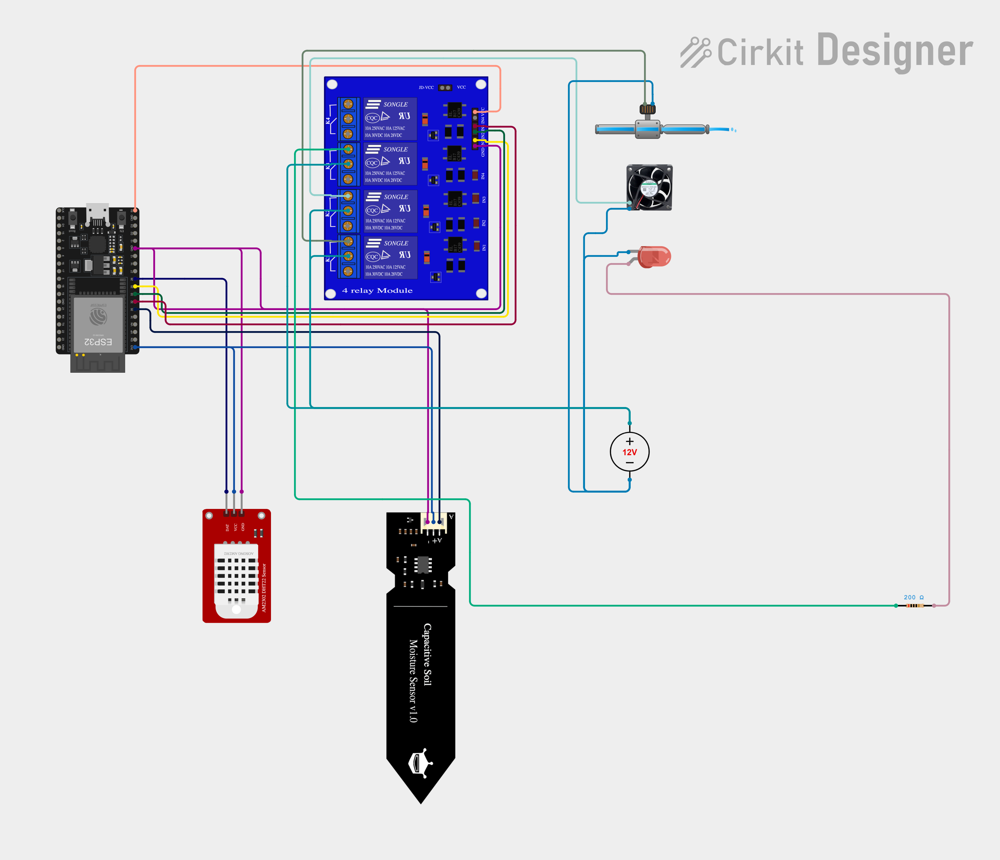

# IOT_GreenHouse — Hệ thống nhà kính thông minh

## Giới thiệu
Đồ án kết thúc học phần môn IoT và ứng dụng: hệ thống giám sát và điều khiển nhà kính theo thời gian thực. ESP32 đọc nhiệt độ, độ ẩm không khí và độ ẩm đất rồi gửi qua MQTT về máy chủ Spring Boot (lưu PostgreSQL); người dùng theo dõi và điều khiển van tưới, quạt, đèn qua Web Dashboard React. Bản đang chạy: https://iot-greenhouse-1.onrender.com/

## Chức năng chính
- **Giám sát thời gian thực:** ESP32 đo mỗi 2 giây, gửi dữ liệu khi thay đổi vượt ngưỡng (|ΔT| ≥ 1°C, |ΔH| ≥ 5%, |ΔS| ≥ 5%) và heartbeat 10 giây; dashboard cập nhật qua WebSocket.
- **Điều khiển van/quạt/đèn từ xa và tự động:** theo ngưỡng có trễ (hysteresis).
- **Chế độ thủ công khóa toàn thiết bị:** bật tay bất kỳ kênh nào khi đang AUTO thì toàn bộ thiết bị sang MANUAL, chỉ về AUTO khi người có thẩm quyền chuyển lại; nút dừng khẩn cấp tắt hết + sang MANUAL; ESP32 mất mạng tự về AUTO để điều khiển offline.
- **Cảnh báo 2 mức WARNING/CRITICAL kèm hành động đề xuất (bật quạt/van/AUTO):** thực thi ngay trên trang cảnh báo (PROCESSED), hủy (CANCELLED), hoặc tự hết hạn (EXPIRED) khi cơ cấu chấp hành được bật; cảnh báo riêng khi thiết bị bị chuyển sang thủ công.
- **Lịch chiếu sáng tự động:** đồng bộ xuống ESP32, thiết bị tự bật/tắt đèn theo giờ lưu trong NVS — chạy cả khi MANUAL và khi mất mạng.
- **Phân quyền 3 vai trò:** ADMIN / OPERATOR / VIEWER, ghi nhật ký kiểm toán mọi thao tác nhạy cảm; quản lý vòng đời thiết bị.

## Sơ đồ mạch


## Linh kiện & Kết nối

| Linh kiện | Kết nối |
| :--- | :--- |
| DHT22 (nhiệt độ, độ ẩm KK) | GPIO 26 |
| HW-390 (độ ẩm đất, analog) | GPIO 35 |
| Relay IN1 — van tưới | GPIO 25 |
| Relay IN2 — quạt | GPIO 33 |
| Relay IN3 — đèn LED có dây sẵn 3–12V (không cần điện trở) | GPIO 32 |

> **Lưu ý nguồn cấp:** Nguồn 12V 3A cấp cho van/quạt/đèn qua tiếp điểm relay (relay Active HIGH); ESP32 và cảm biến dùng nguồn 5V/3.3V riêng.

## Hướng dẫn chạy dự án
- **Yêu cầu:** Java 17, Node.js, Mosquitto MQTT Broker; cơ sở dữ liệu PostgreSQL đã đặt trên Neon Cloud nên không cần cài DB ở máy local.
- **MQTT Broker:** đảm bảo dịch vụ Mosquitto đang chạy (cổng 1883). Trên Windows:
  ```powershell
  Start-Service mosquitto
  ```
- **Backend (cổng 8080):** đặt các biến môi trường cần thiết (mật khẩu admin khởi tạo, email...) theo file `HUONG_DAN_CHAY_LOCAL.txt`, sau đó:
  ```powershell
  cd backend
  .\mvnw.cmd spring-boot:run
  ```
- **Frontend (cổng 5173):**
  ```bash
  cd frontend
  npm install # chỉ lần đầu
  npm run dev
  ```
  Mở [http://localhost:5173](http://localhost:5173) và đăng nhập bằng tài khoản đã khởi tạo.
- **ESP32:** nạp firmware trong thư mục `firmware/`; khi thiết bị phát Wi-Fi `GreenHouse_ESP32_Setup`, vào cổng cấu hình để nhập Wi-Fi nhà và địa chỉ MQTT Broker — thiết bị sẽ tự kết nối và gửi dữ liệu lên dashboard.

> Chi tiết từng bước xem `HUONG_DAN_CHAY_LOCAL.txt`.
